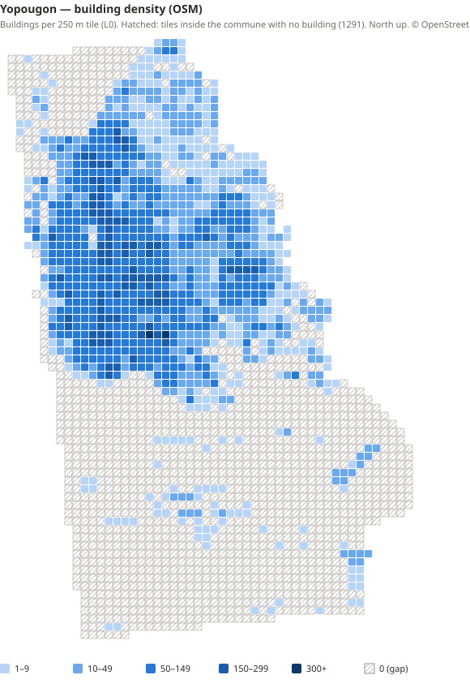

# Spike SP2 — Couverture OpenStreetMap de Yopougon

> Tâche T-018 · 13/10/2026 · Données : Geofabrik `ivory-coast-261001.osm.pbf` (instantané du 01/10/2026) · © les contributeurs d'OpenStreetMap (ODbL)
>
> Chiffres reproductibles : `pnpm map:build --config tools/map-pipeline/config/yopougon.pipeline.json` → `data/build/yopougon/stages/18-report/` (`coverage-report.md`, `coverage-report.json`, `building-density.svg`).

## Verdict

**OSM suffit pour lancer Yopougon**, avec un seul gros manque : **les hauteurs**. Les emprises du bâti, les rues, les lieux et même les **lignes de gbaka et de woro-woro** sont présents et denses dans la zone urbaine. Les hauteurs, elles, sont absentes pour 98,7 % des bâtiments : les heuristiques de T-011 deviennent indispensables, et une source ouverte de hauteurs est recommandée.

## 1. Limite administrative

| | |
|---|---|
| Relation OSM | **`r3377881`** — `name=Yopougon`, `admin_level=8`, `boundary=administrative`, `wikidata=Q1470529` |
| Surface | **149,8 km²** (mesurée en UTM 30N) |
| Emprise | lon −4,1332 → −4,0206 ; lat 5,2344 → 5,4010 |
| Limites de quartiers (admin_level 9/10) | **Aucune** pour Yopougon (Attécoubé en a 27) → 94 quartiers nommés existent seulement sous forme de points `place=*` |

L'identifiant est désormais dans `data/sources/sources.lock.json` et dans `tools/map-pipeline/config/yopougon.pipeline.json`. L'extraction utilise l'emprise de la relation + 300 m (et non plus la bbox provisoire, qui ratait toute la partie sud).

**Fixture « Pigeons »** (Q3) : ses trois points de contrôle (centre et deux coins) sont **à l'intérieur de Yopougon**. ✅

## 2. Bâti

| Mesure | Valeur |
|---|---:|
| Bâtiments dans la commune | **62 496** |
| … avec `height` | 11 (0,02 %) |
| … avec `building:levels` | 831 (1,3 %) |
| `building=yes` (type non précisé) | 96,3 % |
| `apartments` / `residential` / `house` | 1 049 / 627 / 184 |
| Tuiles L0 (250 m) contenant du bâti | 1 127 |

**Tuiles sans bâtiment à l'intérieur de la commune** : 1 291, classées selon l'occupation du sol à leur centre.

| Occupation du sol | Tuiles |
|---|---:|
| Non cartographiée | 761 |
| Cultures / prairies | 186 |
| Autre usage du sol | 148 |
| Forêt (dont Banco) | 113 |
| Eau | 73 |
| Zone humide | 7 |
| Industrie | 3 |

Les 761 tuiles « non cartographiées » se répartissent ainsi :
- **336 au sud de 5,29°** : lagune Ébrié et île Boulay. La lagune n'est tracée que par son trait de côte, et non par un polygone d'eau.
- **293 sur la rive** (5,29° → 5,32°), où se mêlent eau et terre.
- **132 seulement dans la zone urbaine** (≥ 5,32°), **≈ 8 km² de vrais trous probables**.

## 3. Voirie

**1 413 km** de voies, dont 962 km de rues `residential`, 102 km de `service`, 67 km de pistes, 60 km de `tertiary`, 60 km de `footway`, 41 km de chemins, 40 km d'`unclassified`, 21 km d'autoroute, 20 km de `primary` et 18 km de `secondary`. Le réseau est complet et hiérarchisé : il suffit au graphe routier et piéton (étape `roads`).

## 4. Lieux (POI)

**13 944 lieux, dont 76,7 % nommés.** Les catégories dominantes collent parfaitement à la vie quotidienne visée :

| Catégorie | Lieux | Usage dans le jeu |
|---|---:|---|
| `public_transport=platform` | 1 225 | arrêts de gbaka, woro-woro et bus |
| `amenity=pub` | 991 | **maquis** |
| `shop=kiosk` | 916 | kiosques, cabines |
| `amenity=restaurant` | 887 | garba, alloco… |
| `shop=beauty` / `hairdresser` | 665 / 469 | salons, tresses |
| `shop=tailor` / `craft=dressmaker` | 554 / 155 | couturiers |
| `amenity=money_transfer` | 542 | points Mobile Money → **marques à parodier** (ADR 0010) |
| `amenity=place_of_worship` | 512 | églises, mosquées |
| `amenity=school` | 362 | écoles |
| `amenity=pharmacy` / `doctors` | 126 / 138 | santé |

## 5. Transports en commun

**678 relations de lignes** traversent l'extraction, et **1 225 arrêts** se trouvent dans la commune.

| Réseau | Relations |
|---|---:|
| monbus (SOTRA) | 140 (+ 40 navettes, 18 Express, 6 Wibus) |
| Woro-woro banalisé | 139 |
| **Woro-woro de Yopougon** | 116 |
| Gbaka d'Adjamé | 109 |
| **Gbaka de Yopougon** | 52 |
| Gbaka / woro-woro d'Attécoubé, d'Abobo, d'Adjamé | 57 |

C'est une très bonne nouvelle pour le jalon J4 : **les lignes réelles peuvent être importées d'OSM** (étape `transit`) au lieu d'être saisies à la main. Le contenu écrit à la main ne servira qu'aux tarifs et aux fréquences.

## 6. Recommandations

### 6.1. Sources complémentaires (licences à valider avant usage, ARCHITECTURE §21.3, Q8)

| Besoin | Source | Licence (à confirmer) | Priorité |
|---|---|---|---|
| **Hauteurs** (98,7 % manquantes) | Google Open Buildings 2.5D Temporal (hauteurs estimées) | CC BY 4.0 | **Haute** : sinon, heuristiques seules |
| Bâti manquant (≈ 8 km² de trous) | Google Open Buildings v3 ou Microsoft Global ML Building Footprints | CC BY 4.0 / ODbL ; ODbL | Moyenne |
| **Lagune** (eau tracée par le trait de côte) | Polygones d'eau OSM (osmdata.openstreetmap.de) | ODbL | Haute (étape `terrain-water`) |
| Relief | Copernicus DEM GLO-30 | Licence Copernicus (attribution) | Moyenne |

À défaut de source de hauteurs, les heuristiques de T-011 s'appuieront sur le type, la surface et la forme des emprises, ainsi que sur des profils de quartier.

### 6.2. Candidats de quartier pilote pour J1 (fenêtres d'environ 1 km²)

> **Décision du propriétaire (13/10/2026) : pas de quartier pilote — J1 porte directement sur toute la commune de Yopougon.** Les candidats ci-dessous restent utiles comme scènes de référence pour mesurer les performances (zone la plus riche en lieux, zone la plus dense en bâti).

Ils sont classés par densité de bâti et de lieux dans un rayon d'environ 600 m autour du point du quartier.

| # | Quartier(s) | Tuiles L0 | Bâtiments (5×5 tuiles) | Lieux | Intérêt |
|---|---|---|---:|---:|---|
| **1** | **Selmer – Sicogi – Score** | `L0_322..325 × 201..203` | 1 000 – 1 700 | **1 400 – 1 600** | Centre commerçant, la plus forte densité de lieux (maquis, salons, marchés), juste au nord de la fixture Pigeons. **Recommandé.** |
| 2 | Quartier Maroc – Cité Élisée – Gbamnan Djidan | `L0_312..315 × 201..203` | **3 000 – 3 600** | 950 – 1 200 | Bâti résidentiel le plus dense : bon test de performance du rendu |
| 3 | Port-Bouët II – Ananeraie – Cité Saco II | `L0_310..314 × 205..206` | 2 200 – 3 600 | 780 – 1 200 | Quartiers populaires denses, autre ambiance |

### 6.3. Profils de quartiers à créer (J2-03)

OSM n'a **aucune limite de quartier** pour Yopougon. Je propose de commencer par une partition de Voronoï autour des 94 points `place=*`, découpée par la limite communale, puis de faire relire les polygones par le propriétaire.

Les profils de départ, qui servent aux distributions de hauteurs et de styles de façades :
- **Collectif SICOGI** (immeubles R+3 à R+5) : Sicogi, Selmer, Toits-Rouges ;
- **Cours communes** (R+0 à R+1) : Quartier Maroc, Port-Bouët II, Gbamnan Djidan, Ananeraie ;
- **Axes commerçants** (R+1 à R+2) : Siporex, Niangon, Kouté ;
- **Zone industrielle** (entrepôts de 7 à 12 m) ;
- **Villages et habitat lâche** : Andokoi, Micao, la frange ouest ;
- **Île Boulay et rive** : habitat clairsemé, pêche.

## 7. Limites du spike

- Les statistiques sont calculées sur le point représentatif de chaque objet : un bâtiment à cheval sur la limite est compté d'un seul côté.
- Les relations de lignes sont comptées dès qu'elles traversent l'extraction : beaucoup ne font que passer par Yopougon.
- La répartition des tuiles « non cartographiées » par bande de latitude est une approximation. La séparation exacte entre eau et terre viendra avec les polygones d'eau (étape `terrain-water`).
